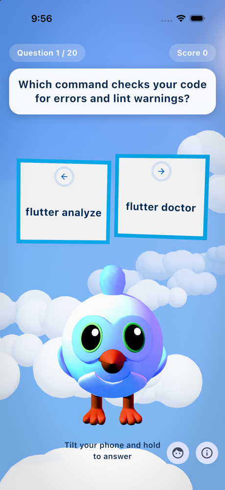
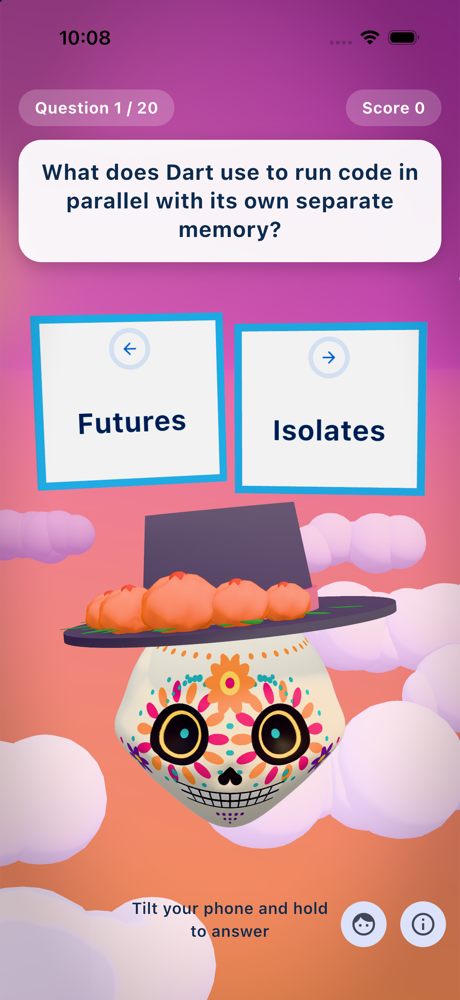

# Dash Quiz

A small Flutter quiz you answer by tilting your phone. Your character, Dash
or La Calavera, flies through a 3D sky, two answers float ahead on boards,
and leaning the phone left or right for two seconds picks one.

The quiz is the excuse. The project exists to show what
[flutter_scene](https://pub.dev/packages/flutter_scene) can do inside an
ordinary Flutter app on iOS and Android.

<p align="center">
  
  &nbsp;&nbsp;
  
</p>

## How it plays

- A question appears at the top of the screen.
- Lean the phone toward the left or right answer and hold it there. A ring
  on that board fills while you hold; level the phone and it resets.
- When the ring completes, the answer is locked in. The correct board turns
  green, a wrong pick drops out of the sky, and the next question flies in.
- No tilt sensor, or testing in a simulator? Press and hold the left or
  right half of the screen instead.
- The face button in the corner switches between Dash and La Calavera, a
  Day of the Dead sugar skull, at any time. Each flies under their own sky.

## How flutter_scene is used

flutter_scene is a 3D engine written in Dart on top of Flutter GPU. Everything
3D here lives in [`lib/presentation/scene/`](lib/presentation/scene/):

| File | What it shows |
| --- | --- |
| `dash_game.dart` | Building a `Scene`, loading `.glb` models with `loadScene`, swapping the visible one, and a `PerspectiveCamera`. |
| `pilot.dart` | A custom `Component` that moves a model every frame and animates named nodes: Dash's wing bones and La Calavera's hat. |
| `cloud_field.dart` | Procedural content: clouds made from shared `SphereGeometry` and one material, recycled as they stream past. |
| `answer_board.dart` | `WidgetComponent`: a live Flutter widget (text, icon, progress ring) rendered onto a surface in the 3D world. |
| `sky.dart` | Two looks, a blue day for Dash and a Day of the Dead dusk for La Calavera: a procedural `GradientSkySource` sky, a shadow-casting `DirectionalLight`, fog, color grading and a vignette through `EnvironmentSettings`, swapped live. |

The scene is drawn by a single `SceneView` widget with normal Flutter widgets
stacked on top of it, so the 2D question card and the 3D world share one
screen.

## Project structure

The code follows a clean-architecture split. Dependencies point inward:
presentation and data depend on domain, and domain depends on nothing.

```
lib/
  domain/         Pure Dart: entities, interfaces, quiz rules
  data/           Bundled questions, accelerometer tilt source
  presentation/
    quiz/         Controller, screen and widgets
    scene/        The flutter_scene world
  main.dart       Wires the concrete classes together
```

The quiz rules (`HoldSelector`, `QuizSession`) and the `QuizController` have
no widget or sensor dependencies, so they are covered by plain unit tests in
[`test/`](test/).

## Running it

You need Flutter 3.47 or newer.

```sh
flutter pub get
flutter run
```

Flutter GPU, which flutter_scene renders through, is already switched on in
`ios/Runner/Info.plist` and `android/app/src/main/AndroidManifest.xml`. The
models in `assets/` are converted at build time by `hook/build.dart`.

La Calavera is not a hand-made model: [`tool/make_calavera.py`](tool/make_calavera.py)
builds `assets/calavera.glb` from scratch, shaping the skull from a sphere
and painting the sugar-skull decoration into its texture. Run it with
`python3 tool/make_calavera.py` after changing the design; it needs only the
Python standard library.

Tilt needs a real device. In a simulator or emulator, use press and hold.

```sh
flutter test      # unit tests
flutter analyze   # static analysis
```

## Contributing

Dash Quiz is open source and contributions are welcome. Good places to start:

- **Questions:** add or improve entries in
  [`local_question_repository.dart`](lib/data/repositories/local_question_repository.dart).
  Keep answers short so they fit on a board.
- **The 3D scene:** particles, Dash's built-in animation clips and camera
  moves are all unexplored.
- **Characters:** add a third one. A `.glb` dropped into `assets/`, an entry
  in `CharacterSpec` (model, pivot, sky), and a node named `Hat` or bones
  named `WingPivot.L`/`.R` are all the pilot needs.

To contribute, open an issue to discuss a larger change, or send a pull
request for a small one at
[github.com/mbcorona/dash_quiz](https://github.com/mbcorona/dash_quiz).
Please run `flutter analyze` and `flutter test` before you submit.

## License

Dash Quiz is released under the [MIT License](LICENSE).

## Credits

- 3D rendering by [flutter_scene](https://github.com/bdero/flutter_scene).
- The Dash model comes from the flutter_scene example assets. Dash and
  Flutter are trademarks of Google; this project is not affiliated with or
  endorsed by Google.
